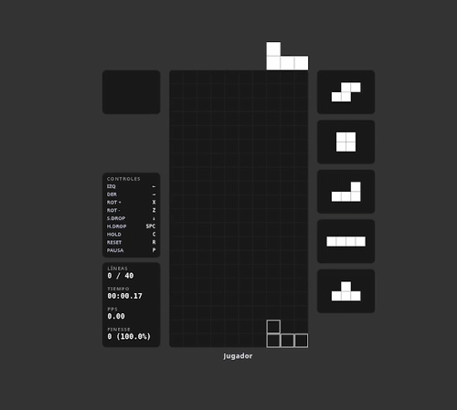

# Prototipo Juego de Bloques

> [!NOTE]
> Copyright © 2026 Pacheco Pablo Matías. Todos los derechos reservados. Este código se publica únicamente con fines de demostración para portafolio. No está permitida su copia, modificación, distribución ni uso comercial sin autorización expresa.

## ❔ Sinopsis

Este proyecto es un prototipo de un juego de rompecabezas de bloques con el objetivo de completar 40 líneas en el menor tiempo posible.

## ⚙️ Funcionalidades

El prototipo consta de las siguientes características y mecánicas:

- Grilla de 10x20.
- Sistema de rotación avanzada con uso de wall kicks *(desplazamientos)*.
- Caída suave y caída rápida.
- Retardo de bloqueo de la pieza.
- Casilleros de próximas piezas y reserva.
- Sistema 7-Bag.
- Pieza fantasma.
- DAS, ARR y SDF configurables, personalización de controles y ajustes visuales y de juego *(guardados localmente en el navegador)*.
- Contador de líneas completadas.
- Cronómetro.
- Medidor de PPS (Piezas Por Segundo).
- Errores y precisión en Finesse.

## 📖 Detalles Técnicos

- **DAS (Cambio Automático Retardado)**: Indica el tiempo de espera antes de que comience el movimiento continuo de la pieza mientras se mantiene presionada una de las teclas direccionales.
- **ARR (Tasa de Repetición Automática)**: Es el intervalo entre cada desplazamiento lateral automático una vez que el DAS termina.
- **SDF (Factor Caída Suave)**:  Es el multiplicador de velocidad de caída suave cuando mantienes presionada la tecla de dicho movimiento.
- **Finesse**: Eficiencia del desplazamiento para colocar una pieza en su destino. En juego competitivo se busca ejecutar la mínima cantidad de entradas necesarias (por lo general hasta 2 movimientos base); los movimientos extra se contabilizan como errores de finesse.
- El sistema de rotación avanzada permite realizar ciertos tipos de giros que normalmente no se pueden hacer tras colisionar contra el límite del tablero o la estructura armada en el mismo, lo cual hará que el juego aplique determinados desplazamientos de acuerdo a la transición de su estado de rotación.
- **Sistema 7-Bag**: Es el sistema de la entrega de piezas. Devuelve un conjunto de 7 piezas distintas ordenadas al azar y esto se repite a lo largo del juego.
## 🖥️ Compatibilidad

Sólo está disponible para navegador (PC).

## 🎮 Controles (predeterminados)
- `Flecha Izquierda` / `Flecha Derecha` -> Movimientos laterales
- `Flecha Abajo` -> Soft Drop
- `Flecha Arriba` -> Giro en sentido horario
- `Z` -> Giro en sentido antihorario
- `Espacio` -> Hard Drop
- `C` -> Reserva
- `R` -> Reset
- `P` -> Pausa

## 📄 Notas

- Este proyecto fue creado con la **ayuda de la IA**.
- El juego **no tiene ningún tipo de sonido ni banda sonora**. Todo lo que se muestra en este proyecto es una representación de las mecánicas implementadas.
- Está en **español**.
- Toda la configuración que apliques en el juego queda guardado en el navegador. Si borras dichos datos o lo juegas en otro navegador o computadora, no tendrás esos ajustes.
- Hecho por Pacheco Pablo Matías.

---

English version (click to expand).

# Blocks Game Prototype

Copyright © 2026 Pacheco Pablo Matías. All rights reserved. This code is published solely for portfolio demonstration purposes. Copying, modifying, distributing, or commercial use is not permitted without express authorization.

## ❔ Overview

This project is a block-puzzle game prototype focused on clearing 40 lines in the shortest time possible.

## ⚙️ Features

The prototype includes the following features and mechanics:

- 10x20 grid
- Advanced rotation system using *wall kicks*
- Soft drop and Hard drop
- Piece lock delay
- Next pieces and Hold slots
- 7-Bag system
- Ghost piece
- Configurable DAS, ARR, and SDF, control customization, and visual/game settings *(persisted locally in the browser)*
- Completed lines counter
- Stopwatch
- PPS (Pieces Per Second) meter
- Finesse error and accuracy

## 📖 Technical Details

- **DAS (Delayed Auto Shift)**: Indicates the wait time before continuous piece movement begins while holding down one of the directional keys.
- **ARR (Auto Repeat Rate)**: The interval between each automatic lateral shift once DAS finishes.
- **SDF (Soft Drop Factor)**: The fall speed multiplier when holding down the soft drop key.
- **Finesse**: Movement efficiency when placing a piece into its target position. In competitive play, the goal is to execute the minimum number of required inputs (generally up to 2 base moves); extra inputs are counted as finesse errors.
- The advanced rotation system allows certain types of spins that normally wouldn't be possible after colliding with the board boundary or the stacked structure, causing the game to apply specific wall/floor kicks depending on the rotation state transition.
- **7-Bag System**: It is the piece-delivery system. It generates a set of 7 distinct pieces in a random order, repeating this throughout the game.

## 🖥️ Compatibility

It is only available for browser (PC).

## 🎮 Controls (default)

* `Left Arrow` / `Right Arrow` -> Lateral movement
* `Down Arrow` -> Soft Drop
* `Up Arrow` -> Clockwise rotation
* `Z` -> Counter-clockwise rotation
* `Space` -> Hard Drop
* `C` -> Hold
* `R` -> Reset
* `P` -> Pause

## 📄 Notes

- This project was created with the help of AI.
- The game **has no sound or soundtrack of any kind**. Everything shown in this project is a representation of the implemented mechanics.
- It is in **Spanish**.
- All settings you apply in the game are saved in the browser. If you clear that data, or play it in another browser or computer, you won't have those settings.
- Made by Pacheco Pablo Matías.

